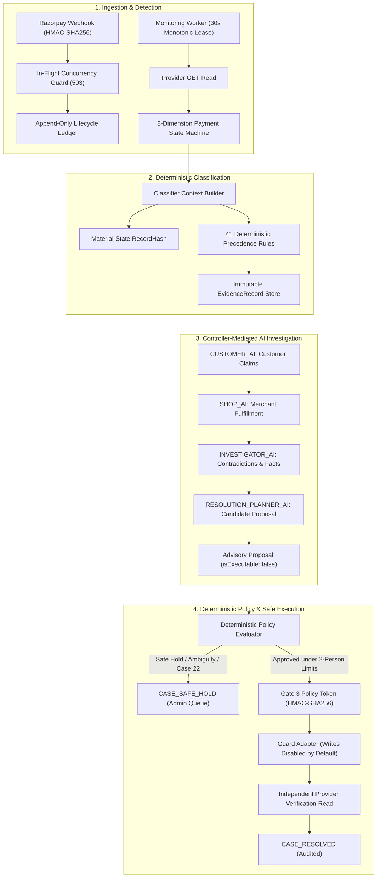

# ReconAI 2.0

> **AI-Assisted Autonomous Payment Monitoring & Resolution Platform**

[](#technology-stack)
[](#verified-benchmark-results)
[-blue.svg)](#verified-benchmark-results)
[](#test-suite--verification)

---

## Canonical Project Vision

**ReconAI 2.0 is an AI-assisted autonomous payment monitoring and resolution platform. It detects payment discrepancies, gathers and correlates evidence from available transaction sources, investigates ambiguous or conflicting payment situations, applies deterministic financial policies, and tracks the safest permitted next action with an auditable history.**

The original Track 4 reconciliation engine remains an underlying evidence collection, integer-paise normalization, and mathematical discrepancy-matching subsystem. ReconAI 2.0 is not positioned merely as an offline batch dashboard; it is a continuous, controller-governed payment monitoring and resolution platform.

---

## The Core Workflow

1. **Detect** an unusual or unresolved payment situation via real-time webhooks, monitoring sweeps, or claim intake.
2. **Collect and validate** transaction, webhook, order, settlement, and provider evidence available to the system.
3. **Classify** the scenario using deterministic rules across 6 priority tiers (41 rules, 30 canonical scenarios).
4. **Investigate** using specialized AI roles in a controller-mediated sequential pipeline:
   - `CUSTOMER_AI`: Analyzes customer-side claims, timestamps, and payment assertions.
   - `SHOP_AI`: Analyzes merchant order, transaction fulfillment, and inventory state.
   - `INVESTIGATOR_AI`: Correlates evidence, identifies missing records and contradictions, and formulates supported findings.
   - `RESOLUTION_PLANNER_AI`: Formulates candidate next-step proposals for policy evaluation.
5. **Apply deterministic backend policy** (`evaluateResolutionPolicy`) to determine which financial actions are permitted under merchant-governed limits.
6. **Monitor, escalate, hold, or perform** an authorized operation through a guarded sandbox adapter (`razorpaySandboxAdapter.js`).
7. **Verify** provider outcomes independently through authoritative GET reads before updating lifecycle states.
8. **Persist** decisions, supporting evidence, lifecycle events, and audit logs with immutable provenance.



### Core Architecture & Financial-Safety Principles

1. **AI Authority is Strictly Advisory**: AI agents formulate non-binding proposals (`isExecutable: false`, `authoritative: false`). AI cannot authorize refunds, modify policy, bypass safe holds, or call provider write endpoints. Server-side policy is authoritative.
2. **Deterministic Matching & Classification**: GroundTruth answer keys are strictly isolated. Classification uses 41 pure, deterministic rules where all 22 safe-hold rules strictly precede all 19 non-safe-hold rules.
3. **Case 22 Non-Negotiable Invariant**: Late capture on a cancelled order (`LATE_CAPTURE_CANCELLED_ORDER`) must remain strictly in `CASE_SAFE_HOLD`, with zero automatic refund and zero automatic reopening of the cancelled order.
4. **Evidence Quality & Ingestion Realism**: A customer debit claim alone is NOT proof of capture. A failed gateway status alone does NOT authorize a refund. Uncaptured funds cannot be refunded by Razorpay; ReconAI monitors banking auto-reversal turnaround times instead.
5. **Provider Sandbox Writes Gated**: Writes are disabled by default (`RAZORPAY_SANDBOX_WRITES_ENABLED=false`), restricted strictly to test keys (`rzp_test_`), require a single-use HMAC `PolicyAuthorizationToken` (Gate 3), enforce atomic conditional refund reservation (`reserveRefund`), and require human `ADMIN` dispatch.
6. **Zero Stale Privileges & Tenant Isolation**: Middleware queries MongoDB directly on every request (`UserAccount.findOne`, `ServicePrincipal.findOne`) with zero in-memory L1 cache in production. Tenant identity is derived solely from verified JWT claims. Auditors are strictly read-only and tenant-scoped unless holding the audited `GLOBAL_AUDIT` scope.
7. **Append-Only Audit Trail**: Every batch run, state change, policy decision, and human review is logged immutably with automatic credential sanitization (`[REDACTED]`). Zero DELETE endpoints exist.

---

## Key Features

- **3-Way Reconciliation**: Reconciles Merchant Orders, Gateway Payments, and Payout Settlement line items.
- **12 Supported Anomaly Classifications**: `MATCHED`, `AMOUNT_MISMATCH`, `MISSING_PAYMENT`, `MISSING_SETTLEMENT`, `DUPLICATE_PAYMENT`, `DUPLICATE_SETTLEMENT`, `FEE_MISMATCH`, `REFUND_MISMATCH`, `REFERENCE_MISMATCH`, `STATUS_MISMATCH`, `AMBIGUOUS`, `INVALID_DATA`.
- **120-Scenario Benchmark Suite**: Pre-seeded synthetic benchmark dataset (`RECONAI_DEMO_V1`, seed `RECONAI_DEMO_2026`).
- **Graceful Failure Showcase (`ORD-000116`)**: When multiple payment candidates exist, ReconAI scores confidence at 45%, blocks automatic resolution, and forces manual review.
- **On-Demand Gemini AI Investigator**: Integrated via official `@google/genai` SDK with Zod runtime validation and 15s timeout policy.
- **Deterministic AI Fallback**: Provides structured, rule-backed explanations if the AI provider is unavailable.
- **Human Decision Workflow**: Human operators choose `KEEP_EXCEPTION`, `APPROVE_MATCH`, or `MARK_RESOLVED`, preserving the original deterministic classification for audit compliance.
- **Razorpay Test Mode Read-Only Adapter**: Fetches live payments (`/v1/payments`) and settlements (`/v1/settlements/recon/combined`) with `validateTestModeSafety()` key protection and customer PII stripping.
- **High-Density React Dashboard**: Built with Vite, React, Tailwind CSS, Recharts, and Lucide React.

---

## Verified Benchmark Results

Measured against pre-seeded synthetic benchmark dataset (`RECONAI_DEMO_V1`):

| Metric | Value | Details |
| :--- | :---: | :--- |
| **Total Scenarios Processed** | **120** | 80 MATCHED, 40 Exceptions |
| **Classification Accuracy** | **100.00%** | 120 / 120 Exact Matches |
| **Exception Precision** | **100.00%** | Zero False Positives |
| **Exception Recall** | **100.00%** | Zero False Negatives |
| **F1 Score** | **100.00%** | Harmonic Mean |
| **Total Value Processed** | **₹10,30,180.00** | 103,018,000 paise |
| **Auto-Reconciled Value** | **₹7,17,020.00** | 71,702,000 paise (80 MATCHED orders) |
| **Held Under Review Value** | **₹3,13,160.00** | 31,316,000 paise (40 Anomaly orders) |

*Note: These 100% metrics are measured against our isolated synthetic GroundTruth benchmark dataset to prove algorithmic correctness, not claimed as universal real-world performance.*

---

## Graceful Failure Showcase: Order `ORD-000116`

ReconAI's core strength is **responsible uncertainty handling**:

- Scenario `ORD-000116` contains two candidate gateway payments (`PAY-000116-A` and `PAY-000116-B`) matching reference parameters with unlinked settlement records.
- Naive algorithms guess; ReconAI scores evidence confidence at **45%** and deterministically classifies the scenario as `AMBIGUOUS`.
- The safety gate locks out automatic resolution and displays:
  > **`Automatic Reconciliation Blocked — Manual Review Required`**
- Gemini or the deterministic fallback explains the candidate ambiguity to the human reviewer.
- Human operator applies `KEEP_EXCEPTION`, leaving the workflow status as `UNDER_REVIEW` while preserving the `AMBIGUOUS` classification for compliance audit.

---

## Safety Invariants Matrix

| Safety Question | Enforced Answer | Implementation Safeguard |
| :--- | :---: | :--- |
| Can Gemini change transaction match classification? | **NO** | Gemini output Zod schema rejects execution actions; matching engine is deterministic. |
| Can Gemini automatically resolve an exception case? | **NO** | AI is advisory-only (`POST /api/exceptions/:id/investigate`). Human action required. |
| Can Gemini be invoked during batch reconciliation? | **NO** | Excluded from batch run orchestration (`reconciliationService.js`). |
| Can an anomaly auto-reconcile because confidence is high? | **NO** | Safety gate forces `allowedAutomaticResolution = false` for all non-MATCHED classes. |
| Can Razorpay adapter perform live write operations or autonomous refunds? | **NO** | Ingestion adapter is strictly read-only (`razorpayClient.js`). A hardened sandbox write adapter (`razorpaySandboxAdapter.js`) exists for test mode write operations, but is disabled by default (`RAZORPAY_SANDBOX_WRITES_ENABLED=false`), restricted to `rzp_test_` keys, strictly requires a signed Gate 3 `PolicyAuthorizationToken` (implemented; verified with mocked provider transport; no real Razorpay test-mode run yet), enforces fail-closed policy limits, prohibits autonomous worker refunds, and restricts provider dispatch exclusively to authenticated human `ADMIN` principals (`POST /api/payment-cases/:caseId/provider/dispatch`; machine identities cannot dispatch). |
| Can live Razorpay keys (`rzp_live_`) be used in Test Mode or Sandbox Writes? | **NO** | Safety invariant throws exception on `rzp_live_` keys across all adapters (`razorpayClient.js`, `razorpaySandboxAdapter.js`). |
| Can GroundTruth answer keys influence matching decisions? | **NO** | GroundTruth imports forbidden in `server/src/services/reconciliation/` (`groundTruthIsolationGuard.test.js`). |
| Can audit trail records be modified or deleted via API? | **NO** | Audit API provides `GET /api/audit` and `GET /api/audit/:id` only. |
| Are Case 1 and Case 8 detectable from standard production payloads? | **NO** | Case 1 is RESERVED (lacks authenticated client telemetry beacon endpoint); Case 8 is SEEDABLE_ONLY (schema supports split capture, but standard Razorpay webhook ingestion has zero production writers for amountAuthorizedPaise/amountCapturedPaise). |

---

## Technology Stack

- **Frontend**: React 18, Vite 5, JavaScript, Tailwind CSS 4, React Router 6, Axios, Recharts, Lucide React
- **Backend**: Node.js 20, Express 4, MongoDB Atlas, Mongoose 8, Zod 3, Pino, Helmet, express-rate-limit
- **AI Engine**: Google Gemini API (`@google/genai` SDK, `gemini-2.5-flash`)
- **Payment Sync Adapter**: Razorpay REST API Test Mode
- **Testing**: Vitest 1.6, Supertest 7

---

## Quick Start & Local Setup

### Prerequisites

- Node.js v18+ installed
- MongoDB Atlas URI or local MongoDB server

### Installation

```bash
# 1. Clone the repository
git clone https://github.com/Pranjal-k22/ReconAI.git
cd ReconAI

# 2. Install dependencies for monorepo
npm install
cd server && npm install
cd ../client && npm install
cd ..
```

### Environment Configuration

Create `server/.env`:
```env
PORT=5000
NODE_ENV=development
CLIENT_URL=http://localhost:5173
MONGODB_URI=your_mongodb_atlas_uri_here

# Optional AI & Integration Keys:
GEMINI_API_KEY=your_gemini_api_key_here
GEMINI_MODEL=gemini-2.5-flash

RAZORPAY_KEY_ID=your_razorpay_test_key_id
RAZORPAY_KEY_SECRET=your_razorpay_test_key_secret
RAZORPAY_MODE=test
```

Create `client/.env`:
```env
VITE_API_BASE_URL=http://localhost:5000/api
```

### Seed Benchmark Data & Start Servers

```bash
# Seed 120-scenario synthetic benchmark dataset into MongoDB
cd server
npm run demo:seed

# Start frontend and backend concurrently from root
cd ..
npm run dev
```

Open browser at `http://localhost:5173`.

---

## Test Suite & Verification

Run server unit tests (795 tests across 80 files):
```bash
npm test --prefix server
```

Run server integration tests against real MongoDB (156 tests across 14 files):
```bash
npm run test:integration --prefix server
```

Run 120-scenario deterministic reconciliation benchmark (100.00% match rate):
```bash
npx vitest run tests/reconciliation/benchmarkCompatibility.test.js --dir server
```

Run production monitoring & provider isolation smoke test (7 gates):
```bash
node server/scripts/monitoringSmokeTest.js
```

Run client unit & workspace invariant tests (26 tests across 5 files):
```bash
npm test --prefix client
```

Build production client bundle:
```bash
npm run build --prefix client
```

---

## Major REST API Endpoints

- `GET /api/health` — System health & DB connection status
- `POST /api/reconciliation/runs` — Trigger batch reconciliation run
- `GET /api/reconciliation/runs` — List reconciliation runs with pagination
- `GET /api/reconciliation/runs/:runId/results` — Fetch filterable run results
- `GET /api/reconciliation/runs/:runId/evaluation` — Evaluate run accuracy against GroundTruth
- `GET /api/exceptions` — List exception queue records
- `POST /api/exceptions/:exceptionId/investigate` — Trigger AI / Fallback investigation
- `PATCH /api/exceptions/:exceptionId/decision` — Submit human review decision
- `GET /api/audit` — Query append-only audit trail
- `GET /api/integrations/status` — Get safe integration status (Gemini, Razorpay, DB)
- `POST /api/razorpay/sync/payments` — Sync Razorpay Test Mode payments (read-only)
- `POST /api/policy-config` — Propose versioned policy limits (`ADMIN` only)
- `GET /api/policy-config` — List tenant policy configuration versions (`ADMIN` / `AUDITOR`)
- `GET /api/policy-config/active` — Get active policy configuration for tenant
- `POST /api/policy-config/:id/approve` — Approve proposed policy configuration (Two-person rule: different `ADMIN`)
- `POST /api/policy-config/:id/reject` — Reject proposed policy configuration (`ADMIN`)
- `POST /api/policy-config/:id/deactivate` — Emergency deactivation of active configuration (`ADMIN`)
- `POST /api/policy-config/:id/rollback` — Propose rollback to prior active version (`ADMIN` only; creates PENDING_APPROVAL version requiring different approver)

---

## Governed Versioned Policy-Limits Configuration (Stage 4B)

> "No monetary limits ship with the repo. Limits exist only as two-person-approved per-tenant records. With none active, refunds fail closed. No UI for configuration yet."

- **Zero Monetary Defaults**: No monetary limits ship with the repository. Refund limits exist exclusively as two-person-approved per-tenant records in `PolicyConfigVersion`.
- **Two-Person Governance Boundary**: An `ADMIN` cannot approve their own proposed configuration (`approvedBy !== proposedBy`). Approval requires a second distinct authenticated platform administrator.
- **Fail-Closed Guarantee**: In the absence of an active configuration or upon deactivation, refund policy evaluation unconditionally yields `INSUFFICIENT_EVIDENCE`. Zero preflight GETs, zero reservations, zero tokens, and zero provider HTTP requests are initiated.
- **Decision Binding & Concurrency Safety**: Policy decisions persist `policyConfigVersion` and `contentHash`. Provider dispatch validates that the active configuration matches the decision state; any divergence aborts with `HTTP 409 POLICY_CONFIG_CHANGED`. `PolicyAuthorizationToken` cryptographically binds version and hash for execution verification.
- **Limit Semantics Plain Meaning**: `maxSingleRefundPaise` caps single refund transaction balance against the verified refundable balance. `maxCumulativeRefundPaise` has **no effect today** because `currentCumulativeDailyPaise` is defaulted to 0 and `maxSingleRefundPaise <= maxCumulativeRefundPaise` is strictly enforced at schema and config level; single limit always triggers first. OWNER DECISION: implement real aggregation, or remove the field. Second ADMIN accounts are provisioned via `accountService.provisionUserAccount`.
- **Honest Scenario Reachability**: 30 deterministic rules are implemented in the classifier. Code-computed reachability breakdown (Stage 5 Part B): **14 PROVEN_FROM_DB**, **3 INGESTION_TIME**, **3 NEEDS_CLAIM_INTAKE**, **8 RESERVED**, **2 NO_SOURCE**. No claim that 30 scenarios are supported end to end from live production feeds without intake routes.


---

## Operator Workspace (Read-Only) (Stage 6B)

The operator workspace (`client`) provides a read-only investigation environment for human controllers and auditors across payment lifecycle cases:

- **Strict Read-Only Enforcement**: The client workspace exports zero mutation functions (no POST, PUT, PATCH, DELETE). It contains no buttons that classify, investigate, dispatch, release, or edit cases.
- **Token-Only Tenant Scoping**: The workspace strictly forbids `x-tenant-id` headers and reads zero tenant parameters from `localStorage` or URL query strings. All tenant scoping originates exclusively from the authenticated JWT token verified on the server.
- **Zero Tenant Selector**: Platform `ADMIN` users operate system-wide; no tenant selector UI exists in this stage to guarantee zero accidental cross-tenant mutation.
- **Fail-Closed Safe-Hold Visibility**: Held cases prominently display active hold reason codes and policies. For Case 22 (`LATE_CAPTURE_CANCELLED_ORDER`), the workspace explicitly displays: *"late capture on a cancelled order: held, no automatic refund or reopen"*.
- **Inert Adversarial Text Rendering**: All customer claims, agent perspectives, and untrusted inputs are rendered strictly as text with truncation and expansion controls (zero `dangerouslySetInnerHTML`, zero markdown/HTML script execution).
- **Local Dev-Only Demo Seeder**: `server/scripts/seedWorkspaceDemo.js` executes exclusively in non-production environments (`NODE_ENV !== "production"`), strictly refusing connection to any database host other than `localhost`/`127.0.0.1` or any database name without `test` or containing `prod`. Passwords must be explicitly provided via the `DEMO_SEED_PASSWORD` environment variable. Zero monetary limits are seeded or defaulted.

---

## Documentation Links

### Core & Hackathon Documents
- [Demo Script Guide (`docs/DEMO_SCRIPT.md`)](file:///c:/WEB%20DEVELOPMENT/ReconAI/docs/DEMO_SCRIPT.md)
- [Judging Criteria Alignment (`docs/JUDGING_CRITERIA.md`)](file:///c:/WEB%20DEVELOPMENT/ReconAI/docs/JUDGING_CRITERIA.md)
- [Submission Checklist (`docs/SUBMISSION_CHECKLIST.md`)](file:///c:/WEB%20DEVELOPMENT/ReconAI/docs/SUBMISSION_CHECKLIST.md)
- [REST API Specification (`docs/API.md`)](file:///c:/WEB%20DEVELOPMENT/ReconAI/docs/API.md)
- [Testing Architecture (`docs/TESTING.md`)](file:///c:/WEB%20DEVELOPMENT/ReconAI/docs/TESTING.md)
- [Elevator Pitch (`docs/PITCH.md`)](file:///c:/WEB%20DEVELOPMENT/ReconAI/docs/PITCH.md)
- [Exception Workflow (`docs/EXCEPTION_WORKFLOW.md`)](file:///c:/WEB%20DEVELOPMENT/ReconAI/docs/EXCEPTION_WORKFLOW.md)
- [AI Investigation Architecture (`docs/AI_INVESTIGATION.md`)](file:///c:/WEB%20DEVELOPMENT/ReconAI/docs/AI_INVESTIGATION.md)
- [Razorpay Integration (`docs/RAZORPAY_INTEGRATION.md`)](file:///c:/WEB%20DEVELOPMENT/ReconAI/docs/RAZORPAY_INTEGRATION.md)

### ReconAI 2.0 Architectural Specifications
- [Current Project Status & Release Readiness (`docs/reconai-2/CURRENT_PROJECT_STATUS.md`)](file:///c:/WEB%20DEVELOPMENT/ReconAI/docs/reconai-2/CURRENT_PROJECT_STATUS.md)
- [Master Documentation Consistency Audit (`docs/reconai-2/DOCUMENTATION_CONSISTENCY_AUDIT.md`)](file:///c:/WEB%20DEVELOPMENT/ReconAI/docs/reconai-2/DOCUMENTATION_CONSISTENCY_AUDIT.md)
- [Open Decisions, Safety Blockers & Technical Debt (`docs/reconai-2/OPEN_DECISIONS_AND_TECHNICAL_DEBT.md`)](file:///c:/WEB%20DEVELOPMENT/ReconAI/docs/reconai-2/OPEN_DECISIONS_AND_TECHNICAL_DEBT.md)
- [Workspace API Read Contract (`docs/reconai-2/API_READ_CONTRACT.md`)](file:///c:/WEB%20DEVELOPMENT/ReconAI/docs/reconai-2/API_READ_CONTRACT.md)
- [Architecture Decisions ADR-01 to ADR-15 (`docs/reconai-2/ARCHITECTURE_DECISIONS.md`)](file:///c:/WEB%20DEVELOPMENT/ReconAI/docs/reconai-2/ARCHITECTURE_DECISIONS.md)
- [Daily Work Log & Audit Trail (`docs/reconai-2/DAILY_WORK_LOG_2026_10_12.md`)](file:///c:/WEB%20DEVELOPMENT/ReconAI/docs/reconai-2/DAILY_WORK_LOG_2026_10_12.md)
- [Acceptance Criteria & Verification Framework (`docs/reconai-2/ACCEPTANCE_CRITERIA.md`)](file:///c:/WEB%20DEVELOPMENT/ReconAI/docs/reconai-2/ACCEPTANCE_CRITERIA.md)
- [Phase 6 Classification Engine & Reachability Matrix (`docs/reconai-2/PHASE_6_CLASSIFICATION_ENGINE.md`)](file:///c:/WEB%20DEVELOPMENT/ReconAI/docs/reconai-2/PHASE_6_CLASSIFICATION_ENGINE.md)
- [Domain Models & Ledgers (`docs/reconai-2/DOMAIN_MODEL_AND_LEDGERS.md`)](file:///c:/WEB%20DEVELOPMENT/ReconAI/docs/reconai-2/DOMAIN_MODEL_AND_LEDGERS.md)
- [Payment State Machine (`docs/reconai-2/PAYMENT_STATE_MACHINE.md`)](file:///c:/WEB%20DEVELOPMENT/ReconAI/docs/reconai-2/PAYMENT_STATE_MACHINE.md)
- [Edge Case Policy Matrix (`docs/reconai-2/EDGE_CASE_POLICY_MATRIX.md`)](file:///c:/WEB%20DEVELOPMENT/ReconAI/docs/reconai-2/EDGE_CASE_POLICY_MATRIX.md)
- [Role & Permission Matrix (`docs/reconai-2/ROLE_PERMISSION_MATRIX.md`)](file:///c:/WEB%20DEVELOPMENT/ReconAI/docs/reconai-2/ROLE_PERMISSION_MATRIX.md)

---

## Limitations

- Synthetic benchmark is a controlled dataset (120 scenarios) fulfilling Track 4 deterministic verification.
- Razorpay live financial mutations (captures, refunds, payouts) are intentionally disabled (`RAZORPAY_SANDBOX_WRITES_ENABLED=false`); integration uses mocked provider transports.
- Provider operations on the workspace detail screen represent synthetic records.
- Admin tenant switching UI is scheduled for a future release; currently `ADMIN` operates across all tenant records without a dropdown selector.
- Case 18 and Case 23 remain unreachable in production due to upstream schema normalizer fail-closed validation.

---

## License

MIT License — ReconAI Hackathon Team
