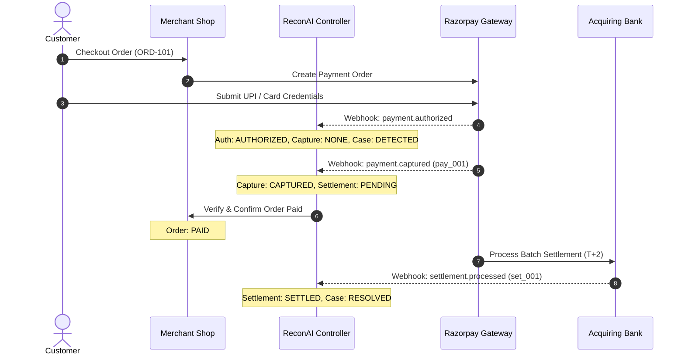
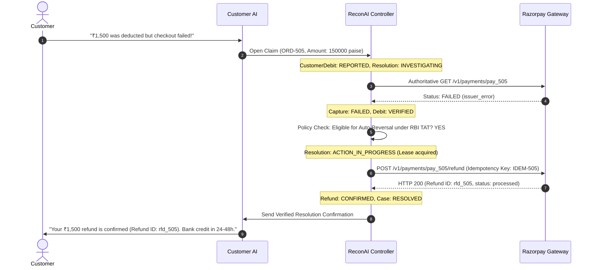
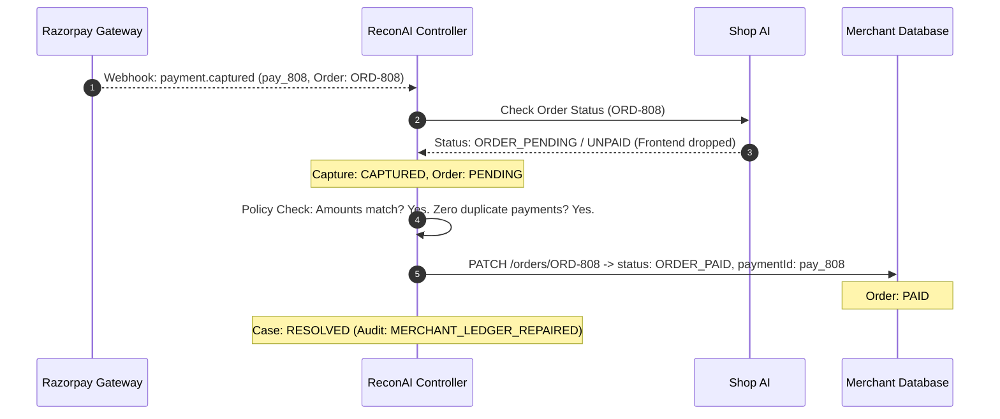
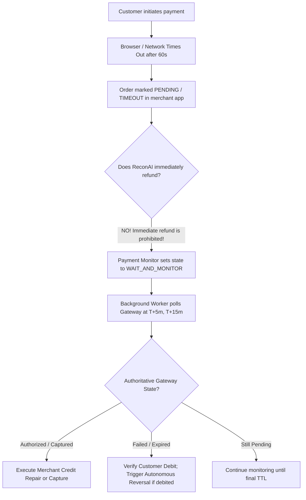

# ReconAI 2.0 — Canonical Payment State Machine & Lifecycle Specification

> **DOCUMENT STATUS: PROPOSED — AWAITING OWNER REVIEW**  
> *This document specifies the canonical multi-dimensional payment state machine, lifecycle transitions, event sequencing rules, and recovery behaviors for ReconAI 2.0. No application code has been modified.*

---

## 1. Architectural Philosophy: Multi-Dimensional State

In real-world payment engineering, **collapsing payment status into a single enum is a critical design flaw**. 
A single status such as `"FAILED"` fails to distinguish between:
- A payment that failed before debit vs. a payment that failed after debit.
- A payment that succeeded at the gateway vs. a merchant order that was never marked paid.
- A payment that was captured vs. funds that have settled into the merchant's bank account.

ReconAI 2.0 maintains an **8-Dimensional Canonical State Machine** for every transaction:

```text
┌────────────────────────────────────────────────────────────────────────┐
│               RECONAI 2.0 MULTI-DIMENSIONAL TRANSACTION STATE          │
├────────────────────────────────┬───────────────────────────────────────┤
│ 1. Merchant Order State        │ CREATED | PENDING | PAID | CANCELLED  │
│ 2. Customer Debit Claim State  │ NONE | REPORTED | VERIFIED | REVERSED │
│ 3. Gateway Authorization State │ NONE | AUTHORIZED | EXPIRED | VOIDED  │
│ 4. Gateway Capture State       │ NONE | CAPTURED | PARTIAL | FAILED    │
│ 5. Settlement Payout State     │ NONE | PENDING | SETTLED | ADJUSTED   │
│ 6. Refund State                │ NONE | ELIGIBLE | PENDING | CONFIRMED │
│ 7. Dispute / Chargeback State  │ NONE | INQUIRY | FORMAL | WON | LOST  │
│ 8. Case Resolution State       │ DETECTED | INVESTIGATING | RESOLVED   │
└────────────────────────────────┴───────────────────────────────────────┘
```

---

## 2. Canonical State Machine Dimensions & Enums

### Dimension 1: Merchant Order State (`orderState`)
Tracks internal merchant e-commerce order fulfillment intent:
- `ORDER_CREATED`: Order record created in merchant database; awaiting checkout.
- `ORDER_PENDING`: Customer is at checkout; payment initiation in progress.
- `ORDER_PAID`: Merchant has verified payment receipt; fulfillment authorized.
- `ORDER_PARTIALLY_PAID`: Partial amount paid (if split payments supported).
- `ORDER_CANCELLED`: Customer or merchant cancelled order prior to or after payment.
- `ORDER_FULFILLED`: Goods shipped or service rendered.

### Dimension 2: Customer Debit Claim State (`customerDebitState`)
Tracks consumer bank account debit reporting:
- `DEBIT_NONE`: No claim or evidence of customer deduction.
- `DEBIT_REPORTED`: Customer reported money deducted via Customer AI or support ticket.
- `DEBIT_VERIFIED`: Provider status (`payment.captured` or issuer failure payload with debit flag) or bank UTR/RRN confirms funds left customer account.
- `DEBIT_REVERSED`: Bank or gateway auto-reversal confirmed; funds returned to customer.

### Dimension 3: Gateway Authorization State (`authorizationState`)
Tracks card/UPI mandate hold at payment gateway:
- `AUTH_NONE`: No authorization requested or initiated.
- `AUTH_PENDING`: Mandate/hold in flight with card network or NPCI.
- `AUTH_AUTHORIZED`: Two-factor authentication passed; funds held on customer line of credit/account.
- `AUTH_EXPIRED`: Authorization window lapsed without capture (standard Razorpay auth timeout is 5–10 days).
- `AUTH_VOIDED`: Authorization explicitly cancelled before capture.

### Dimension 4: Gateway Capture State (`captureState`)
Tracks actual fund acquisition by merchant gateway account:
- `CAPTURE_NONE`: Payment not attempted or not authorized.
- `CAPTURE_CAPTURED`: Gateway has successfully captured the funds into merchant account.
- `CAPTURE_PARTIALLY_CAPTURED`: Partial amount captured (if partial capture supported).
- `CAPTURE_FAILED`: Payment attempt failed at gateway (insufficient funds, gateway error, drop-off).

### Dimension 5: Settlement Payout State (`settlementState`)
Tracks physical movement of funds from acquiring gateway to merchant's bank account:
- `SETTLEMENT_NONE`: Transaction not captured or ineligible for settlement.
- `SETTLEMENT_PENDING`: Captured funds held in gateway settlement cycle (standard $T+2$ or $T+1$ window).
- `SETTLEMENT_SETTLED`: Gateway has transferred net funds to merchant bank via NEFT/RTGS; UTR generated.
- `SETTLEMENT_ADJUSTED`: Funds deducted for refund, fee correction, or dispute reserve.

### Dimension 6: Refund State (`refundState`)
Tracks return of funds to original payment source:
- `REFUND_NONE`: No refund requested or warranted.
- `REFUND_ELIGIBLE`: Case policy verifies customer is owed a refund.
- `REFUND_INITIATED`: Refund request dispatched to provider API with idempotency key.
- `REFUND_PENDING`: Provider acknowledged refund creation; bank processing in flight.
- `REFUND_CONFIRMED`: Provider and bank confirm credit to customer account (`refund.processed`).
- `REFUND_FAILED`: Refund rejected by acquiring bank or gateway (`refund.failed`).

### Dimension 7: Dispute / Chargeback State (`disputeState`)
Tracks formal bank disputes and consumer chargebacks:
- `DISPUTE_NONE`: Clean transaction with no formal dispute.
- `DISPUTE_INQUIRY`: Issuer pre-arbitration retrieval request.
- `DISPUTE_FORMAL_CHARGEBACK`: Customer filed official chargeback with issuing bank; funds debited.
- `DISPUTE_UNDER_REVIEW`: Evidence submitted to provider for representment.
- `DISPUTE_WON`: Merchant won dispute; funds re-credited.
- `DISPUTE_LOST`: Customer won dispute; funds permanently debited.

### Dimension 8: Case Resolution State (`resolutionCaseState`)
Tracks autonomous lifecycle of the issue inside ReconAI Controller:
- `CASE_DETECTED`: Inconsistency detected; case record created.
- `CASE_INVESTIGATING`: Multi-agent evidence gathering and diagnosis in progress.
- `CASE_PENDING_POLICY`: Investigator proposed action; policy engine evaluating invariants.
- `CASE_ACTION_IN_PROGRESS`: Authorized provider action dispatched under lock lease.
- `CASE_VERIFYING_OUTCOME`: Action executed; polling or awaiting outcome confirmation.
- `CASE_RESOLVED`: Authoritative final state confirmed; audit sealed; parties notified.
- `CASE_SAFE_HOLD`: Automated action halted due to risk, fraud, or ambiguity; routed to admin.
- `CASE_EXTERNAL_ESCALATION`: Escalated to partner bank or legal dispute team.

---

## 3. Lifecycle State Transition Diagrams

### 3.1 Happy Path Lifecycle (Smooth Payment & Settlement)



---

### 3.2 Failure & Autonomous Reversal Path (Customer Debited on Failed Gateway)



---

### 3.3 Merchant Ledger Repair Path (Payment Succeeded, Order Unpaid)



---

### 3.4 Late Authorization Path (Timeout Followed by Late Success)



---

## 4. Valid vs. Invalid State Transitions

To guarantee data integrity, the state machine strictly enforces **Monotonic Progression** and blocks **Illegal State Regressions**:

### 4.1 Permitted Transitions Table

| Current State Dimension | Allowed Next States | Trigger / Authoritative Evidence |
| :--- | :--- | :--- |
| `orderState: ORDER_CREATED` | `ORDER_PENDING`, `ORDER_CANCELLED` | Customer enters checkout OR cancels cart. |
| `orderState: ORDER_PENDING` | `ORDER_PAID`, `ORDER_CANCELLED` | Validated captured payment OR explicit timeout cancellation. |
| `orderState: ORDER_PAID` | `ORDER_FULFILLED`, `ORDER_CANCELLED` | Merchant shipment dispatch OR authorized order cancellation. |
| `authorizationState: AUTH_NONE` | `AUTH_PENDING`, `AUTH_AUTHORIZED` | Mandate initialization OR successful authentication webhook. |
| `authorizationState: AUTH_AUTHORIZED` | `AUTH_EXPIRED`, `AUTH_VOIDED` | TTL expiry OR merchant void request. |
| `captureState: CAPTURE_NONE` | `CAPTURE_CAPTURED`, `CAPTURE_FAILED` | Authoritative provider webhook `payment.captured` or `payment.failed`. |
| `settlementState: SETTLEMENT_NONE` | `SETTLEMENT_PENDING` | Triggered when `captureState` reaches `CAPTURE_CAPTURED`. |
| `settlementState: SETTLEMENT_PENDING` | `SETTLEMENT_SETTLED`, `SETTLEMENT_ADJUSTED` | Bank settlement recon file with UTR OR debit adjustment. |
| `refundState: REFUND_NONE` | `REFUND_ELIGIBLE` | Policy engine approves refund proposal. |
| `refundState: REFUND_ELIGIBLE` | `REFUND_INITIATED` | Provider write adapter dispatches refund call with idempotency key. |
| `refundState: REFUND_INITIATED` | `REFUND_PENDING`, `REFUND_CONFIRMED`, `REFUND_FAILED` | Provider HTTP response OR subsequent `refund.processed`/`refund.failed` webhook. |
| `resolutionCaseState: CASE_DETECTED` | `CASE_INVESTIGATING` | Evidence collection completed. |
| `resolutionCaseState: CASE_INVESTIGATING` | `CASE_PENDING_POLICY`, `CASE_SAFE_HOLD` | Diagnosis formulated OR high-risk ambiguity flagged. |
| `resolutionCaseState: CASE_PENDING_POLICY` | `CASE_ACTION_IN_PROGRESS`, `CASE_SAFE_HOLD` | Policy engine signs authorization token OR rejects recommendation. |
| `resolutionCaseState: CASE_ACTION_IN_PROGRESS` | `CASE_VERIFYING_OUTCOME`, `CASE_SAFE_HOLD` | Provider acknowledges action dispatch OR network error occurs. |
| `resolutionCaseState: CASE_VERIFYING_OUTCOME` | `CASE_RESOLVED`, `CASE_SAFE_HOLD` | Provider authoritative verification completes. |

### 4.2 Strictly Prohibited Transitions (Anti-Patterns)
The following state regressions are rejected with a `StateTransitionInvariantError`:
1. **Regressing Final Capture**: `CAPTURE_CAPTURED` $\rightarrow$ `CAPTURE_FAILED` or `CAPTURE_NONE` is strictly forbidden. Once captured, only refunds or chargebacks can alter fund balances.
2. **Regressing Final Settlement**: `SETTLEMENT_SETTLED` $\rightarrow$ `SETTLEMENT_PENDING` is strictly forbidden.
3. **Reverting Confirmed Refund**: `REFUND_CONFIRMED` $\rightarrow$ `REFUND_PENDING` or `REFUND_NONE` on arrival of stale or delayed webhooks.
4. **Premature Resolution**: `resolutionCaseState` transitioning to `CASE_RESOLVED` while any sub-state is in `REFUND_INITIATED`, `AUTH_PENDING`, or `SETTLEMENT_PENDING` without verified closure.
5. **Direct LLM Transition**: No state transition may occur without a cryptographic webhook event, server GET verification response, or policy engine signed execution token.

---

## 5. Event Sequencing & Out-of-Order Webhook Resolution

In internet payment architectures, webhooks often arrive out of order (e.g., `refund.processed` arrives before `refund.created`, or a delayed `payment.authorized` arrives after `payment.captured`).

```text
Incoming Webhook Event
         ↓
Check IngestedWebhookEvent (Duplicate ID?)
    ├── YES → Return HTTP 200 (Acknowledge & Drop)
    └── NO  → Record Event ID in MongoDB
         ↓
Evaluate State Monotonicity & Event Timestamp:
    ├── If Event Timestamp < Last Applied State Timestamp:
    │     Drop stale event payload, log WARN audit event.
    └── If Event indicates advanced state (e.g. CAPTURED when current is NONE):
          Query Server-Side Authoritative GET /v1/payments/:id
          Reconstruct full chronological history from provider truth.
          Apply state transitions monotonically.
```

### Deterministic Event Precedence Rules:
1. **Cryptographic Gateway Webhook** > Client-side Redirect Payload.
2. **Server-Side GET Query** > Asynchronous Webhook Stream.
3. **Bank UTR Settlement Record** > Estimated Settlement Schedule.
4. **Older Timestamps Never Overwrite Newer Timestamps**.
