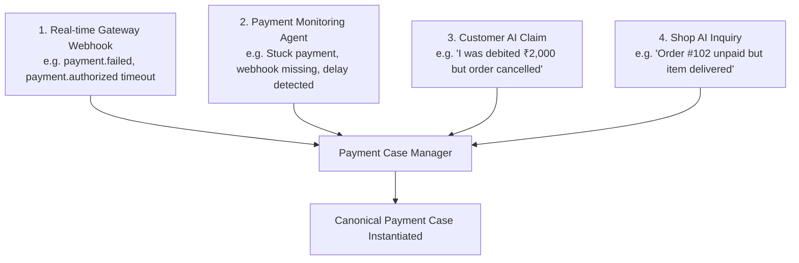
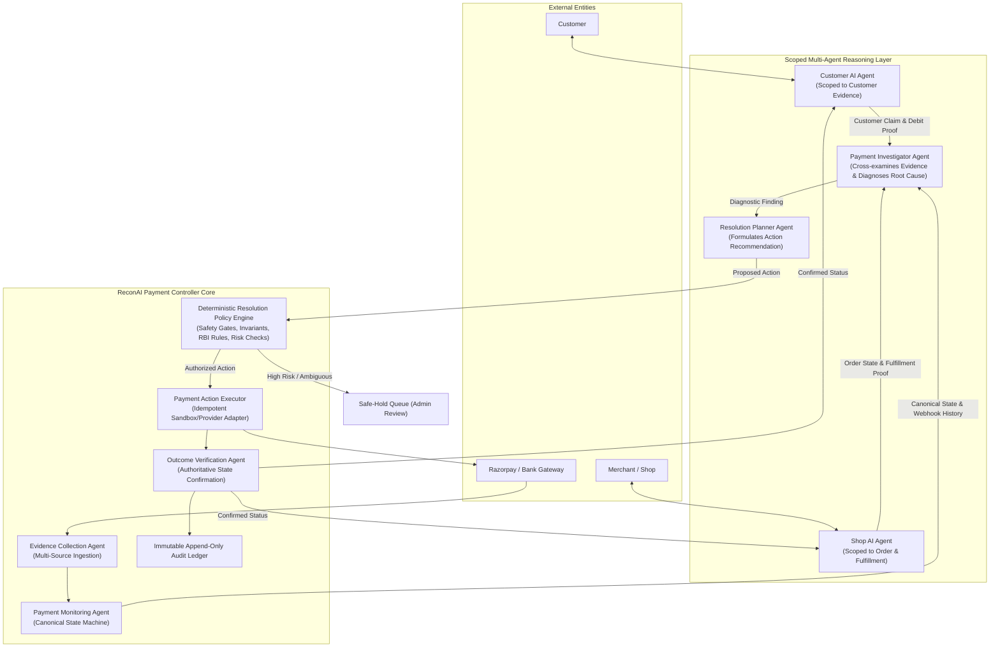

# ReconAI 2.0 — Product Requirements Document (PRD)

> **DOCUMENT STATUS: PROPOSED — AWAITING OWNER REVIEW**  
> *This document represents the target product specification and system requirements for ReconAI 2.0. No application code has been modified.*

---

## 1. Executive Summary & Vision

### 1.1 Product Identity
**ReconAI 2.0 — Autonomous AI Payment Monitoring & Resolution Controller**

### 1.2 Evolution from ReconAI 1.0 to 2.0
In **ReconAI 1.0**, the platform was positioned primarily as a merchant-facing, verification-first financial reconciliation dashboard. It ingested batch records (Orders, Gateway Payments, Settlements), performed deterministic matching using integer paise arithmetic, flagged discrepancies into a human-review queue, invoked Google Gemini strictly for advisory explanations, and logged actions to an immutable audit trail.

In **ReconAI 2.0**, ReconAI expands from an offline batch dashboard into a **continuous, autonomous AI payment monitoring and resolution platform**. 

The core mission:
> **Monitor every payment from initiation through final settlement, detect incomplete, ambiguous, or inconsistent payment states across consumers, merchants, and gateways, coordinate scoped Customer AI and Shop AI agents to investigate evidence, and autonomously resolve eligible routine payment exceptions through verified payment-provider actions—without requiring the customer or merchant to contact their bank.**

The existing deterministic reconciliation engine from Track 4 is **retained intact** as the core financial evidence and benchmark validation subsystem underneath the autonomous controller.

---

## 2. Problem Statement & Customer Experience

### 2.1 The Core Problem
In digital payment ecosystems (especially UPI, Cards, NetBanking, and Wallets in India governed by RBI frameworks and powered by gateways such as Razorpay), ordinary transactions frequently enter ambiguous failure states:

```text
Customer Pays 
      ↓ 
Network Drop / Gateway Timeout / Webhook Loss / Settlement Delay
      ↓ 
Payment State Ambiguity
      ↓ 
Customer doesn't know: 
• "Was I charged?" 
• "Did the shop get my money?" 
• "Will I get my money back?" 
• "Do I need to file a chargeback or call my bank?"
```

Currently, resolving this requires:
1. The customer calling their bank or arguing with merchant customer support.
2. The merchant manually checking their gateway dashboard, orders DB, and bank statements.
3. Days of manual ticket escalation, customer frustration, and unnecessary bank chargebacks.

### 2.2 Target Personas & Use Cases

1. **The Consumer (`CUSTOMER`)**:
   - *Pain Point*: ₹2,000 debited from UPI/card, but the checkout page failed or merchant app shows "Order Pending/Unpaid".
   - *Goal*: Instant automated clarification ("Where is my money?") and autonomous resolution (order credited or money refunded automatically per RBI auto-reversal rules) without dialing the bank.

2. **The Merchant / Shop Operations (`SHOP`)**:
   - *Pain Point*: Order marked pending or unpaid, but funds might be sitting captured in the gateway, or settlement is delayed by the acquiring bank.
   - *Goal*: Avoid chargeback fees, avoid wrongful order cancellations, and automatically repair local order ledgers when payment capture is verified.

3. **The Finance Controller / System Administrator (`ADMIN`)**:
   - *Pain Point*: Reconciling thousands of daily transactions, handling edge cases, and preventing fraudulent claims.
   - *Goal*: Autonomous resolution of routine eligible cases (target $\ge 80\%$), complete observability over live transactions, automated RBI compliance, and safe-hold containment for high-risk anomalies.

4. **The Compliance Auditor (`AUDITOR`)**:
   - *Pain Point*: Verifying whether automated refunds or credits complied with merchant policy, gateway truth, and financial regulations.
   - *Goal*: 100% immutable, tamper-evident audit trails with cryptographic evidence links for every autonomous action.

---

## 3. How a Payment Issue Becomes a Case

A `PaymentCase` is instantiated in ReconAI through one of four triggers:



1. **Gateway Event Ingestion**: An authoritative webhook arrives from Razorpay indicating a state discrepancy (e.g., `payment.authorized` without capture within timeout, or `payment.failed` with suspected debit).
2. **Autonomous Monitoring Sweep**: The background Payment Monitoring Agent identifies a payment whose state hasn't advanced within expected SLAs (e.g., payment captured 48 hours ago but settlement missing, or checkout timed out).
3. **Customer AI Interaction**: The customer asks Customer AI via the storefront or support widget: *"₹2,000 was deducted from my account for order ORD-1234, but the app says failed."* Customer AI validates ownership and opens an investigated claim.
4. **Shop AI Interaction**: The merchant ERP or shopkeeper flags an order where fulfillment is on hold due to missing payment confirmation.

---

## 4. Multi-Agent Autonomous Resolution Ecosystem

ReconAI 2.0 employs a coordinated, multi-agent architecture with strict boundaries of responsibility and data isolation:



### 4.1 Responsibilities of Each Agent

| Agent Identity | Role & Boundaries | Information Accessed | Information Prohibited |
| :--- | :--- | :--- | :--- |
| **Payment Monitoring Agent** | Continuous watcher of payment lifecycles and canonical state transitions. | Webhook stream, provider status queries, state timestamps. | Customer chat history, raw merchant accounting. |
| **Evidence Collection Agent** | Gathers and cryptographically anchors data from Gateway, Merchant Orders, Settlements, and Bank reports. | Gateway payment objects, settlement recon CSVs, merchant orders. | Private API secrets, plain-text customer cards/passwords. |
| **Customer AI Agent** | Customer advocate. Answers user queries and collects debit evidence. | Authenticated customer's orders, payment status, customer-provided UTR/claim. | Other customers' data, merchant internal margins/fees, provider secret keys. |
| **Shop AI Agent** | Merchant advocate. Inquires about unpaid orders and inventory status. | Merchant's order records, internal fulfillment state, settlement payouts. | Unrelated merchant stores, customer personal PII (email, card details). |
| **Payment Investigator Agent** | Diagnostic intelligence. Cross-examines Customer + Shop + Gateway + Settlement evidence to find root causes. | Normalized case evidence bundle from all approved sources. | Direct provider API write access (read-only diagnostic). |
| **Resolution Planner Agent** | Formulates a structured resolution proposal based on diagnosis. | Investigator diagnostic finding, merchant refund policy rules. | Direct execution authority. |
| **Resolution Policy Engine** | **Deterministic server-side gate**. Validates eligibility, idempotency, risk, amounts, and regulatory rules. | Authoritative database records, policy invariants, active locks. | Non-deterministic inputs; ignores LLM instructions that violate rules. |
| **Payment Action Executor** | Executes approved action against Payment Provider API using idempotency keys. | Authorized action payload, provider adapter credentials. | Executing any action without a signed Policy Authorization token. |
| **Outcome Verification Agent** | Queries provider to confirm that requested refund/credit achieved final state. | Provider API response, subsequent webhooks, bank UTR. | Marking case resolved before provider confirms. |

---

## 5. Normalized Outcomes Taxonomy

To ensure clarity and prevent confusion between *proposals*, *actions*, and *states*, ReconAI 2.0 strictly normalizes its outcomes across three distinct domains:

### 5.1 Recommendations (AI Proposal)
Formulated by the Resolution Planner Agent:
- `RECOMMEND_WAIT_FOR_SETTLEMENT`: Payment captured; merchant settlement pending in normal window.
- `RECOMMEND_RECHECK_PROVIDER`: Gateway status transient or pending; poll provider.
- `RECOMMEND_CREDIT_SHOP_ORDER`: Payment captured at gateway; repair merchant local order ledger.
- `RECOMMEND_REFUND_CUSTOMER`: Payment failed/cancelled or duplicate; customer debit verified.
- `RECOMMEND_SAFE_HOLD`: High risk, ambiguous payment candidate, or conflicting evidence detected.
- `RECOMMEND_EXTERNAL_ESCALATION`: Fraud allegation, formal chargeback, or bank regulatory dispute.

### 5.2 Actions (Policy Authorization & Execution)
Validated and executed by Server Policy & Provider Adapter:
- `ACTION_WAIT_AND_MONITOR`: Case scheduled for automated background polling (e.g., check in 30s).
- `ACTION_POLL_PROVIDER_STATUS`: Immediate server-side GET query to provider for authoritative state.
- `ACTION_UPDATE_MERCHANT_LEDGER`: Server-side API call updating merchant order to `PAID`.
- `ACTION_EXECUTE_PROVIDER_REFUND`: Server-side call to provider Refund API with idempotency key.
- `ACTION_LOCK_SAFE_HOLD`: Case frozen; automated actions halted; routed to human admin console.
- `ACTION_ESCALATE_DISPUTE`: Case assigned to merchant dispute management workflow.

### 5.3 Case Lifecycle States (Case Manager)
Monitored by the Payment Controller:
- `DETECTED`: Case opened via webhook, claim, or monitor.
- `INVESTIGATING`: Evidence collection and multi-agent cross-examination in progress.
- `PENDING_POLICY`: Recommendation submitted; awaiting deterministic policy validation.
- `ACTION_IN_PROGRESS`: Authorized provider action dispatched with a verified Gate 3 `PolicyAuthorizationToken` and atomic refund reservation; awaiting callback/verification.
- `VERIFYING_OUTCOME`: Action executed; authoritative GET read verification or confirmation webhook required before transition to `RESOLVED`.
- `RESOLVED`: Authoritative outcome confirmed by provider; audit log sealed; parties notified.
- `SAFE_HOLD`: Suspended due to risk or ambiguity; awaiting manual operator decision.
- `ESCALATED`: Referred to external bank/legal/dispute process.

> **Stage 3 Provider Mutation Safety Guarantees**: Provider write actions (`ACTION_EXECUTE_PROVIDER_REFUND`) are executed through a dedicated hardened sandbox adapter (`razorpaySandboxAdapter.js`). Sandbox writes are disabled by default (`RAZORPAY_SANDBOX_WRITES_ENABLED=false`), restricted strictly to test keys (`rzp_test_...`), require a cryptographically signed HMAC-SHA256 `PolicyAuthorizationToken` (Gate 3), enforce atomic conditional refund reservation (`reserveRefund`), and fail closed when policy limits are missing in production. Live writes are strictly prohibited.


---

## 6. End-to-End User Experience Scenarios

### Scenario A: Fully Autonomous Merchant Credit Repair (Customer Does Nothing)
1. **Event**: Customer pays ₹2,000 for order `ORD-9871`. Razorpay captures payment `pay_ABC123`.
2. **Issue**: Due to network drop between browser and merchant server, merchant shop order remains `PENDING`.
3. **Customer asks Customer AI**: *"I paid ₹2,000 but the screen showed an error. Did my order go through?"*
4. **ReconAI Controller Execution**:
   - Payment Monitoring Agent detects captured payment `pay_ABC123` linked to `ORD-9871`.
   - Shop AI verifies: Order `ORD-9871` exists, currently unpaid, inventory reserved.
   - Payment Investigator diagnoses: `Root Cause: FRONTEND_NOTIFICATION_DROPPED; Gateway: CAPTURED; Shop: UNPAID`.
   - Resolution Planner recommends: `RECOMMEND_CREDIT_SHOP_ORDER`.
   - Resolution Policy Engine verifies: Amount matches (200000 paise), currency matches (INR), payment captured, zero refunds issued $\rightarrow$ **AUTHORIZES UPDATE**.
   - Action Executor updates Merchant Order to `PAID` with payment reference `pay_ABC123`.
   - Verification Agent confirms merchant ledger updated.
5. **Customer AI informs Customer**: *"Good news! Your payment of ₹2,000 was successfully verified with Razorpay. Your order #ORD-9871 is now confirmed and being prepared."*
6. **Result**: Zero human involvement. Case resolved in 4.2 seconds.

### Scenario B: Fully Autonomous Customer Refund (Customer Does Not Call Bank)
1. **Event**: Customer attempts payment of ₹1,500. Gateway payment fails due to issuer timeout.
2. **Issue**: Customer's bank account was debited, but Razorpay marks payment `pay_XYZ789` as `FAILED`.
3. **Detection**: Customer AI registers claim with UPI reference / RRN, OR webhook `payment.failed` arrives with debit claim.
4. **ReconAI Controller Execution**:
   - Evidence Collector verifies authoritative gateway status is `FAILED`.
   - Shop AI confirms merchant received ₹0 and order was cancelled.
   - Investigator diagnoses: `Root Cause: CUSTOMER_DEBIT_ON_FAILED_GATEWAY; Gateway: FAILED; Merchant: UNPAID; Debit: REPORTED`.
   - Resolution Planner recommends: `RECOMMEND_REFUND_CUSTOMER`.
   - Resolution Policy Engine checks:
     - Is payment captured? No.
     - Has merchant delivered goods? No.
     - Is auto-reversal eligible under RBI Turnaround Time (TAT) framework? **YES**.
     - Has a refund or reversal already been executed? No.
     - Idempotency key generated: `IDEM-REF-XYZ789-20261011`.
   - Action Executor dispatches refund / reversal check to payment provider API.
   - Provider returns `refund_id: rfd_999`, status: `processed`.
   - Verification Agent verifies refund completion at provider.
5. **Customer AI informs Customer**: *"We verified with the payment gateway that your transaction failed after deduction. A full refund of ₹1,500 has been autonomously initiated to your original payment method (Refund ID: rfd_999). Expected credit timeline: 24–48 hours per RBI guidelines."*
6. **Result**: Customer did not contact bank. Merchant did not process manual ticket.

### Scenario C: Safe-Hold for High-Risk Ambiguity (Safety First)
1. **Event**: Order `ORD-000116` has two separate gateway payments of ₹5,000 attempted within 3 minutes (`pay_116A` and `pay_116B`). Both show `AUTHORIZED`.
2. **ReconAI Controller Execution**:
   - Investigator identifies ambiguity: Cannot deterministically confirm which payment represents legitimate intent and whether merchant can fulfill duplicate inventory.
   - Resolution Planner recommends: `RECOMMEND_SAFE_HOLD`.
   - Policy Engine locks case into `SAFE_HOLD`.
   - Autonomous refund/capture is **STRICTLY BLOCKED**.
3. **Notification**: Admin dashboard displays alert on Exception Console. Customer AI informs customer: *"Your payment is currently under priority safety verification with our finance desk to avoid duplicate billing. We will notify you within 15 minutes."*

---

## 7. Legal & Regulatory Alignment (RBI & Razorpay)

ReconAI 2.0 is designed directly in accordance with authoritative Indian financial regulations and gateway security standards:

1. **Reserve Bank of India (RBI) Harmonisation of Turnaround Time (TAT) and Customer Compensation Framework**:
   - *Source*: RBI Circular DPSS.CO.PD No.629/02.01.014/2019-20 (Framework for Turnaround Time for failed transactions and compensation).
   - *Requirement*: For failed transactions where customer account is debited but beneficiary/merchant account is not credited (UPI, Card-Not-Present, e-wallets), auto-reversal must occur within prescribed timelines ($T+1$ for UPI, $T+5$ for card e-commerce). If system auto-reverses autonomously, customer friction and statutory penalty exposures ($₹100/\text{day}$ delay) are eliminated.

2. **Razorpay Integration & Security Standards**:
   - *Source*: Razorpay Security Checklist & Payment Webhooks Documentation (2025/2026).
   - *Requirement*: Validate webhook authenticity using HMAC-SHA256 signature verification. Never trust client-side redirect responses; verify state directly from server-side APIs before fulfilling orders or moving funds.

---

## 8. Open Questions & Assumptions for Owner Review

1. **Assumption A1**: Customer debit verification for failed payments will initially rely on Razorpay gateway status (`payment.failed` with gateway failure reason) and Customer AI claim intake, with future integration for direct bank UPI RRN inquiry APIs.
2. **Assumption A2**: During Phase 1 and Phase 2 development, all payment provider write operations will execute exclusively in **Simulated Dry-Run** or **Razorpay Test Sandbox** mode. Live financial transactions remain completely prohibited.
3. **Open Question Q1**: Should merchants be permitted to define custom auto-refund velocity thresholds (e.g., max ₹10,000 auto-refunded per day per customer without manual approval)?
4. **Open Question Q2**: For customer-reported debits where the gateway has zero record of any transaction (e.g., bank outage before gateway was reached), should ReconAI hold the case for $T+24\text{ hours}$ before advising the customer to contact the issuing bank?
